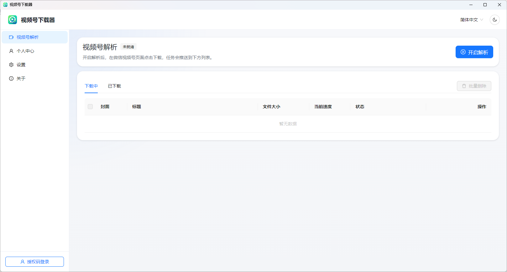
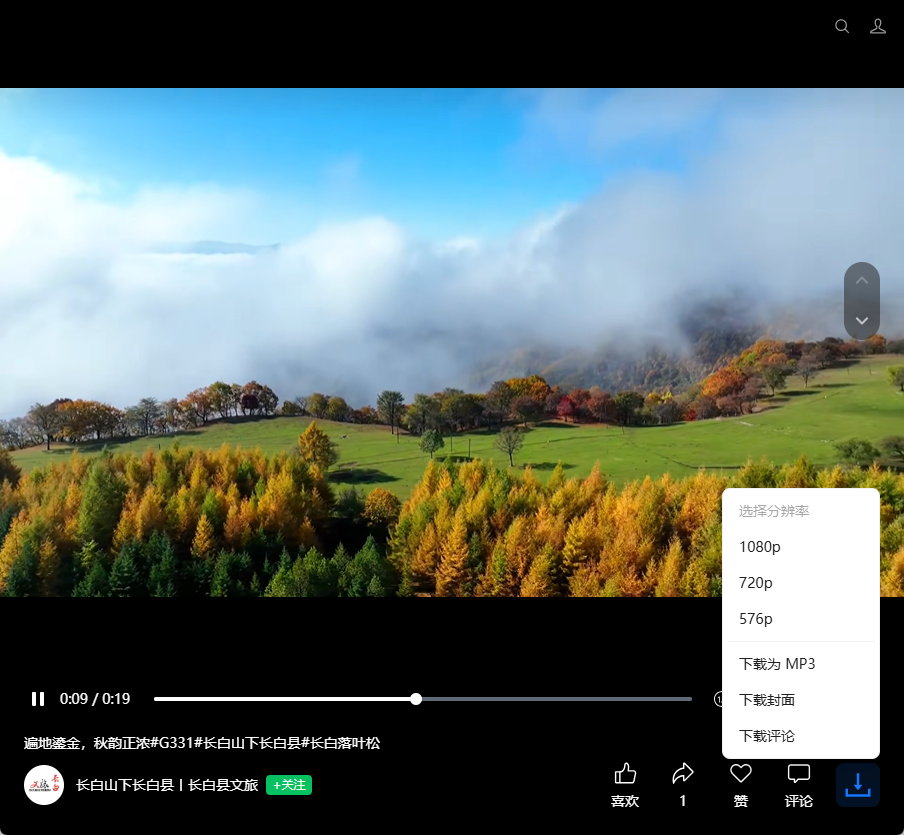
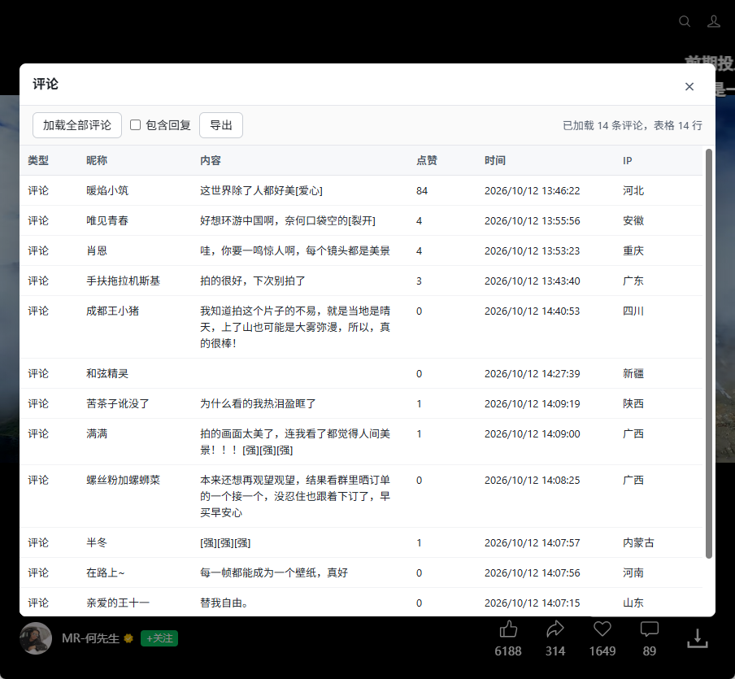
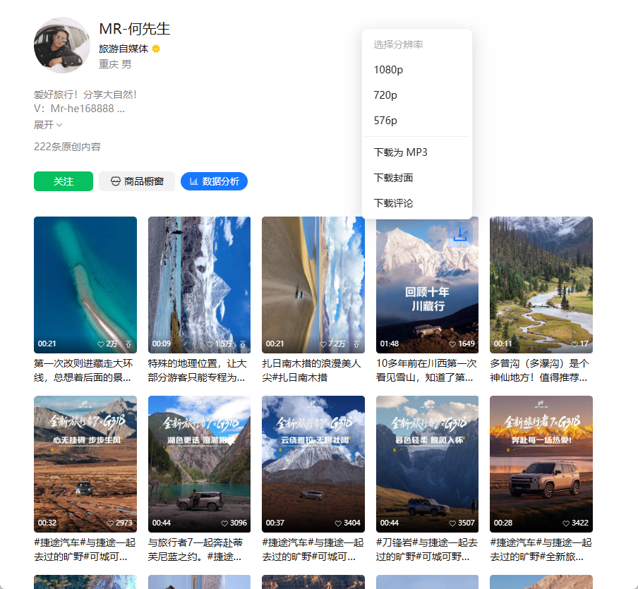
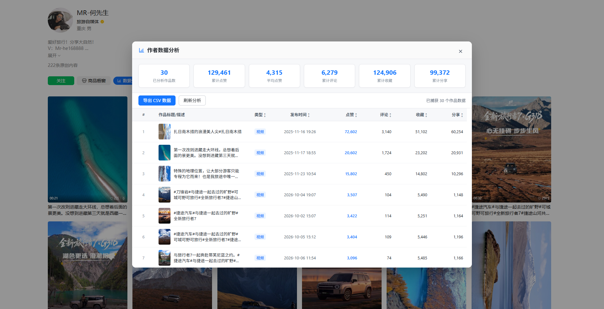
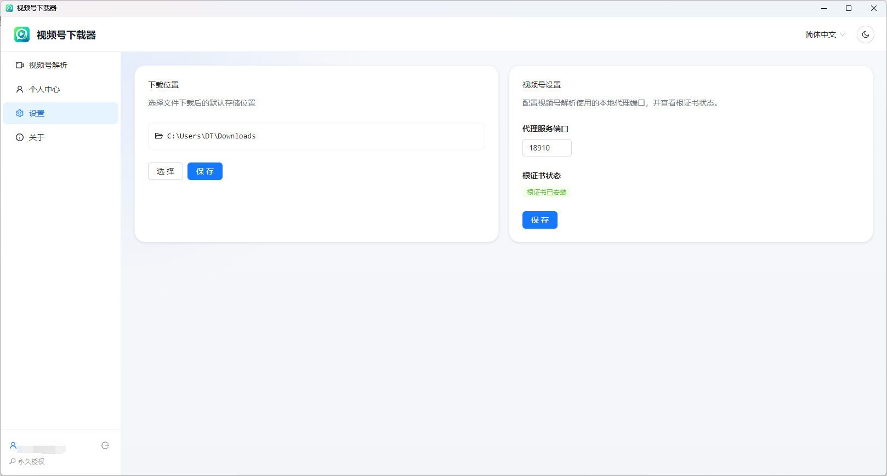

# 视频号下载器（We-VDL）

在微信视频号网页里，一键下载视频、MP3、封面和评论，还能批量分析作者作品数据并导出 CSV。

## 下载安装

| 系统 | 版本 | 下载链接 |
| --- | --- | --- |
| Windows | x64 | [we-vdl-win-latest-x64.exe](https://oss.snappdown.com/prod/wevdl/app/windows/we-vdl-win-latest-x64.exe) |
| macOS | Apple 芯片（arm64） | [we-vdl-mac-latest-arm64.dmg](https://oss.snappdown.com/prod/wevdl/app/mac/we-vdl-mac-latest-arm64.dmg) |

链接始终指向最新版本，安装后软件内也会提示更新。

## 功能亮点

### 视频一键下载，多种分辨率可选

在视频号网页的播放页里，视频右下角会多出一个下载按钮。点击后可以选择 1080p、720p、576p 等分辨率，也可以直接下载为 MP3，或者只保存封面。

### 评论查看与导出

菜单里的「下载评论」会打开评论面板。面板里可以：

- 加载全部评论，可选择是否包含回复
- 查看评论类型、昵称、内容、点赞数、时间和 IP 属地
- 一键导出为表格

### 作者主页：列表直接下载

在作者主页的作品列表里，鼠标移到作品封面上就会出现下载按钮，同样支持选择分辨率、下载 MP3、封面和评论，不用逐条点进视频。

### 作者数据分析与 CSV 导出

在作者主页点击「数据分析」，可以统计已加载作品的整体表现：作品数、累计点赞、平均点赞、累计评论、累计收藏和累计分享。下方的作品明细支持按点赞、评论、收藏、分享排序，并可以导出为 CSV。

### 下载管理

软件主界面是下载管理中心：

- 「下载中」和「已下载」两个列表，展示封面、标题、文件大小、当前速度和状态
- 支持批量选择、批量删除，下载完成后可直接打开文件所在位置
- 支持简体中文等多语言，以及浅色 / 深色主题

### 简单的设置

可以自定义视频保存位置，并在设置页查看根证书安装状态。

## 使用方法

1. 下载并安装对应系统的安装包，启动「视频号下载器」。
2. 使用授权码登录（在「个人中心」查看授权状态）。
3. 在主界面点击「开启解析」，按提示完成根证书安装。首次开启时，macOS 可能需要输入开机密码确认。
4. 打开微信视频号网页，在视频页或作者主页点击下载按钮即可。
5. 下载任务会显示在软件的「下载中」列表，完成后在「已下载」里查看。

> 不用时，在软件里点击「停止解析」即可。

## 常见问题

**浏览器提示「您的连接不是私密连接」（`ERR_CERT_AUTHORITY_INVALID`）？**
说明根证书还没有被系统信任。请在软件的「设置」里确认根证书状态；如果显示未安装，先点击「停止解析」再重新「开启解析」，并按提示完成证书安装，然后重启浏览器。

**macOS 提示无法打开软件？**
请把应用拖进「应用程序」后再打开。若仍被拦截，到「系统设置 → 隐私与安全性」中选择「仍要打开」。

**视频没有 1080p 选项？**
可选分辨率取决于视频本身，软件只会列出视频号提供的清晰度。

## 声明

本软件仅供个人学习和合法用途。请遵守相关法律法规和平台规则，尊重内容创作者的版权，下载内容请勿用于侵权或商业传播。
